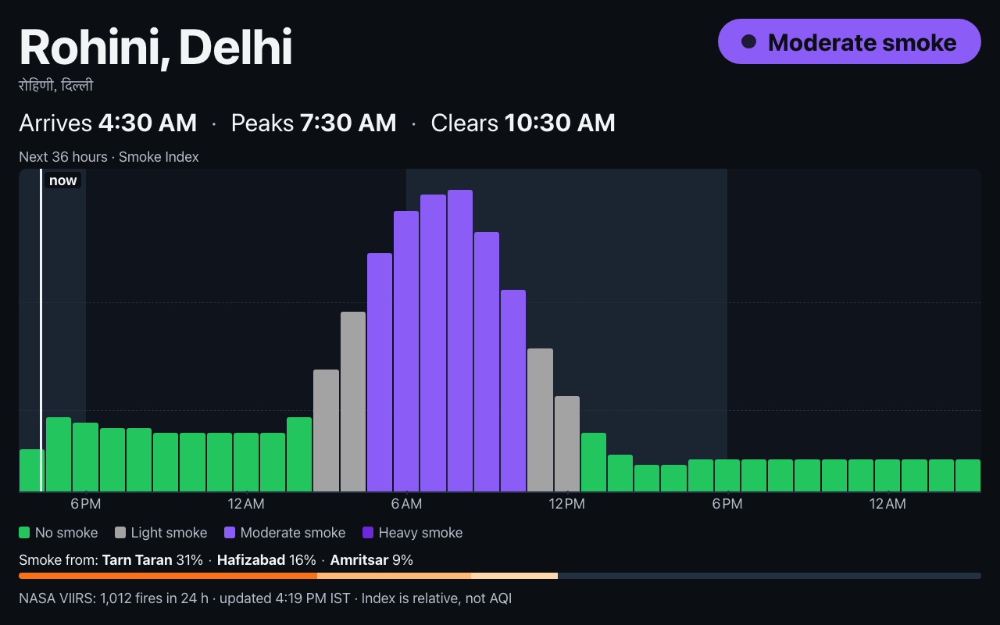
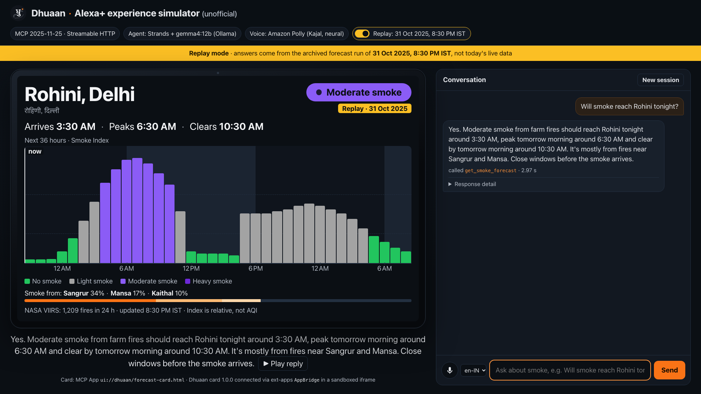
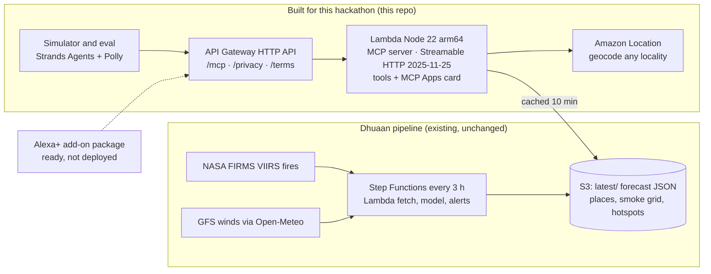
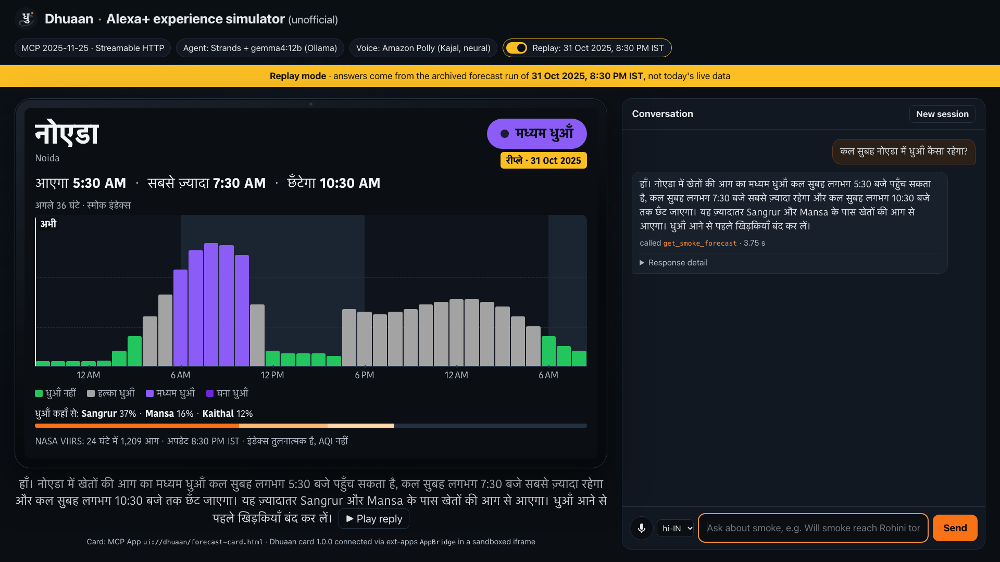

# Dhuaan for Alexa+: will smoke reach my home tonight?

Ask Alexa+ whether farm-fire smoke will reach your home tonight, and get a live satellite-and-wind forecast for north India in Hindi or English, with clean-air windows and an Echo Show timeline card.

   

Built for the Amazon Developer Hackathon "Build, Ship, Shape" (Alexa+ track) on 23 Oct 2026. It runs on [Dhuaan](https://main.d300fn6sn0z3go.amplifyapp.com/), a crop-fire smoke forecast for north India (Runner-up, WeMakeDevs × AWS *Environmental Hacks*, Oct 2026).





*Alexa+ experience simulator (unofficial): Strands agent + Amazon Polly + MCP Apps card, replaying the evening of 31 Oct 2025.*

## Try it in 60 seconds

**MCP endpoint** (public, no auth, Streamable HTTP, protocol 2025-11-25):

```
https://nd0fnh12rd.execute-api.ap-south-1.amazonaws.com/mcp
```

With the MCP Inspector:

```bash
npx @modelcontextprotocol/inspector --cli https://nd0fnh12rd.execute-api.ap-south-1.amazonaws.com/mcp --transport http --method tools/list
```

Or in the Inspector UI: Transport → Streamable HTTP → paste the URL → Connect → Tools → `get_smoke_forecast` with `{"place": "Rohini"}`.

With curl:

```bash
curl -s https://nd0fnh12rd.execute-api.ap-south-1.amazonaws.com/mcp \
  -H 'content-type: application/json' -H 'accept: application/json, text/event-stream' \
  -d '{"jsonrpc":"2.0","id":1,"method":"tools/call","params":{"name":"get_smoke_forecast","arguments":{"place":"Rohini","replay_date":"2025-10-31"}}}'
```

```jsonc
{"result":{"content":[{"type":"text","text":"Yes. Moderate smoke from farm fires should reach Rohini tonight around 3:30 AM, peak tomorrow morning around 6:30 AM and clear by tomorrow morning around 10:30 AM. It's mostly from fires near Sangrur and Mansa. Close windows before the smoke arrives."}],
 "structuredContent":{"kind":"forecast","level_24h":"moderate","arrival":1761948000,"peak":{"t":1761958800,"index":55,"level":"moderate"},"sources":[{"label":"Sangrur","state":"Punjab","pct":34}, …], …}}, …}
```

Drop `replay_date` for the live forecast. Winds can carry smoke away from Delhi on a given day, so the replay of 31 Oct 2025 is the reliable way to see a heavy night.

## What you can ask

| You say | Tool | You get |
|---|---|---|
| "Will smoke reach Rohini tonight?" | `get_smoke_forecast` | Whether smoke comes, when it arrives, peaks and clears, how heavy, and which districts' fires |
| "Where is it coming from?" (follow-up) | `get_smoke_forecast` | Source districts with their share |
| "When can my kids play outside in Gurugram tomorrow?" | `find_clean_air_window` (`kids_play`) | The cleanest 2-hour daylight window, and hours to avoid |
| "Should our school in Dwarka hold assembly outdoors tomorrow?" | `find_clean_air_window` (`school_morning`) | Outdoor OK / keep PE light / move indoors |
| "When should I open the windows in Faridabad?" | `find_clean_air_window` (`ventilate`) | When to air out the house, and when to close up |
| "How many stubble fires did satellites see today?" | `get_farm_fire_activity` | Today's count by state, and the clusters putting smoke over the most people |
| "क्या आज रात रोहिणी में धुआँ आएगा?" | `get_smoke_forecast` (`hi`) | "हाँ। रोहिणी में खेतों की आग का मध्यम धुआँ आज रात लगभग 3:30 बजे पहुँच सकता है…" |
| "Gurgaon mein walk ke liye best time kya hai?" | `find_clean_air_window` | Hinglish works too: it resolves Gurgaon → Gurugram |
| "Will smoke reach Mumbai?" | `get_smoke_forecast` | A polite "outside the forecast area" |
| "Is the air going to be bad tonight?" | (none) | The server instructions make the assistant ask "Which area or city?" first |

## Why Alexa+, and why now

- **Alexa+ launched in India on 16 Sep 2026 (Early Access), in Hindi and English** ([TechCrunch](https://techcrunch.com/2026/09/16/amazon-launches-alexa-in-india-with-hindi-support/)).
- **October–November is crop-burning season.** Smoke from Punjab and Haryana typically reaches Delhi NCR around 3 AM, when a shallow night-time layer traps it near the ground.
- **A forecast, not a reading.** AQI apps tell you once you're already breathing it. Dhuaan tells you before, so families can decide: close the windows tonight? Can the kids play after school? Should assembly be indoors tomorrow?

## How it works



**The forecast in five lines** (details in the Dhuaan repo):
1. NASA FIRMS VIIRS fire detections from 3 satellites are clustered and weighted by fire radiative power.
2. GFS 925 hPa winds (via Open-Meteo) move one smoke puff per cluster per hour, with an RK2 integrator in 15-minute steps, for 36 hours.
3. The puffs spread and decay into a relative 0–100 Smoke Index on a 0.1° grid (74.0–78.4°E, 27.6–31.7°N).
4. Each of 29 named places gets an hourly series, plus attribution to source districts.
5. The pipeline re-runs every 3 hours on AWS and publishes JSON to S3. This server only reads it.

**Does it work?** Dhuaan's replay of **31 Oct 2025** uses only the fires and winds known at 20:30 IST that evening. It put smoke over north-west Delhi around 03:30 IST, peaking near 06:30. The next day Delhi's AQI rose from 218 to 251, and the worst station was **Wazirpur, in north-west Delhi**. One day is not proof, but the direction and timing are consistent. [Open the replay](https://main.d300fn6sn0z3go.amplifyapp.com/?replay=2025-10-31).

## The Alexa+ experience, simulated

The hackathon's resources page describes the Alexa+ track as "build a working MCP (Model Context Protocol) integration on the open standards for Agent Skills and Streamable HTTP transports. You can simulate an Alexa+ experience using your preferred agentic tools via a web app." So the demo is a local web app, the **Alexa+ experience simulator (unofficial)**. It is not Alexa+ and it was not run on an Echo device.

`browser (smart-display UI, MCP Apps host) → local sim_server.py (Strands agent + Amazon Polly) → this MCP server on Lambda`

- **Agent:** [Strands Agents](https://strandsagents.com) with `gemma4:12b` running locally through Ollama. Bedrock Nova 2 Lite is the default model in the code, but Bedrock was blocked for our account ([F5](docs/FRICTION_LOG.md)), so every run here used Gemma.
- **Skill:** the agent's system prompt is built from [`skills/dhuaan-smoke/SKILL.md`](skills/dhuaan-smoke/SKILL.md) (an Agent Skill) plus the server's own `instructions`.
- **Voice:** Amazon Polly neural Kajal (`hi-IN` for Hindi, `en-IN` otherwise) speaks every answer.
- **Card:** the Echo Show card renders in a sandboxed iframe through the MCP Apps `AppBridge`. A badge shows when a past day is being replayed.
- When exactly one tool is called, the simulator speaks the tool's own summary, so numbers never drift. Follow-up turns use the model's wording.

```bash
ollama pull gemma4:12b
cd ui && npm ci && npm run build
cd ../eval && uv run sim_server.py --url https://nd0fnh12rd.execute-api.ap-south-1.amazonaws.com/mcp --model ollama:gemma4:12b
# open http://127.0.0.1:8787 (Chrome; needs AWS credentials for Polly)
```

| # | Mode | Question | Result |
|---|---|---|---|
| 1 | Replay 31 Oct 2025 | Will smoke reach Rohini tonight? | Pass: arrives 3:30 AM, peaks 6:30 AM, from Sangrur and Mansa; card with replay badge |
| 2 | Replay | Where is it coming from? (follow-up) | Partial: names Sangrur and Mansa; Kaithal (third source) is on the card, not in the spoken reply |
| 3 | Replay | Should my kids' school in Dwarka hold assembly outside tomorrow? | Pass: "move assembly and PE indoors" |
| 4 | Replay | कल सुबह नोएडा में धुआँ कैसा रहेगा? | Pass: Hindi reply, Hindi card labels, Kajal in hi-IN |
| 5 | Replay | When should I open the windows in Faridabad? | Pass: open 2:30–4:30 PM, close by 4:30 PM |
| 6 | Live | How many farm fires did satellites see today? | Pass: 1,228 fires (281 Indian Punjab, 22 Haryana), top cluster Hafizabad in Pakistan's Punjab |
| 7 | Live | Will smoke reach Mumbai? | Pass: polite out-of-area reply |
| 8 | Live | Is the air going to be bad tonight? | Pass: asks which area, no tool call |



## MCP implementation details

- **Official SDK v2:** `@modelcontextprotocol/server` 2.3.1 (TypeScript). `initialize` with `protocolVersion: "2025-11-25"` returns `"2025-11-25"`. The server also serves 2026-07-28 clients through `createMcpHandler`.
- **Stateless Streamable HTTP with plain JSON responses.** For 2025-era clients there is one `McpServer` plus `WebStandardStreamableHTTPServerTransport({ sessionIdGenerator: undefined, enableJsonResponse: true })` per POST. `GET`/`DELETE /mcp` return 405, and JSON-RPC batches return 400.
- **Origin check:** a request with an `Origin` header that isn't localhost gets 403. This is the spec's DNS-rebinding guard; Alexa's server-to-server calls send no Origin.
- **2025-11-25 metadata:**
  - `serverInfo` has `title`, `websiteUrl` and `icons`;
  - server `instructions` teach the assistant to use IST, reply in the user's language, lead with the answer, ask for a place if none was given, and never call the relative index "AQI";
  - every tool has a `title`, `icons`, read-only `annotations` and an **`outputSchema`**, and returns **`structuredContent`** plus a short spoken summary.
- **MCP Apps:** all three tools link `_meta.ui.resourceUri = "ui://dhuaan/forecast-card.html"`. That resource (`text/html;profile=mcp-app`) is one self-contained 223 KB HTML file built with `@modelcontextprotocol/ext-apps` 2.0.3, with no network access. It renders a 36-hour timeline, the clean-air window, or today's fires, in English or Hindi.
- **Voice-first summaries:** at most a few short sentences, answer first, IST with day words ("tonight around 3:30 AM", "आज रात लगभग 3:30 बजे"), no AQI, no index numbers, no URLs, no emojis. The wording is ported from Dhuaan's reviewed Telegram bot.
- **Place resolution:**
  1. Dhuaan's 29 forecast places, plus 90 localities geocoded and verified with Amazon Location (`server/src/gazetteer.json`), with Hindi names and aliases ("Gurgaon", "Dilli", "CP", "Sector 62 Noida").
  2. Jaro-Winkler fuzzy matching (≥ 0.9) for transliterations such as "Rohni" and "Gurgoan".
  3. Live Amazon Location geocoding for anything else (India-only, biased to Delhi, 350 ms timeout).
  4. A place outside the grid gets `out_of_area`, and nothing found gets `clarify`. Neither is an error.
- **Caching:** the forecast JSON is read from S3 in parallel and kept in memory for 10 minutes; if a refresh fails, stale data is served with `stale: true`. Replays are cached in an LRU of 3.
- **Logging:** one JSON line per tool call (`tool, place_in, place_id, match, level, ms`). No IPs or headers. CloudWatch keeps it for 30 days.

### Measured latency

From Vividh's laptop in India to ap-south-1, `tools/call get_smoke_forecast`, 50 calls per run, first call excluded (`scripts/latency.mjs`):

| Run | p50 | p95 | max | first call |
|---|---|---|---|---|
| 1 | 72 ms | 97 ms | 137 ms | 215 ms |
| 2 | 71 ms | 88 ms | 109 ms | 210 ms |

- **Alexa+'s limit is 500 ms.** Warm handler time is 0–3 ms; the physics runs offline every 3 hours, and at request time the server only samples a cached grid.
- **Cold start, reported honestly:** Lambda init is 347 ms, then 223 ms to load the forecast from S3 on the first call.
- Provisioned concurrency isn't available on this account (see [friction log F3](docs/FRICTION_LOG.md)), so a 5-minute EventBridge ping keeps an instance and its cache warm.

## Evaluation

Does a language model pick the right tool? 24 utterances in English, Hindi and Hinglish, run through the same Strands agent as the simulator (`eval/run_eval.py`, temperature 0). Model: gemma4:12b via Ollama (local) through Strands. Bedrock Nova 2 Lite is the default in code; it was blocked for our account (F5). This is a stand-in orchestrator, not Alexa+.

| Run | Tool accuracy | Place accuracy | Activity accuracy | Answers with a time | Agent p50 / p95 | Tool p50 / p95 |
|---|---|---|---|---|---|---|
| v1 | 95.8% (23/24) | 100% (18/18) | 100% (11/11) | 52.6% (10/19) | 2.89 / 3.69 s | 0.116 / 0.20 s |
| v2 | 95.8% (23/24) | 100% (18/18) | 100% (11/11) | 52.6% (10/19) | 2.89 / 3.62 s | 0.085 / 0.17 s |

By language (both runs): English 8/9, Hindi 8/8, Hinglish 7/7. v2 added "always call the tools" and "protective step only if smoke is expected" to the server instructions, and named the Indian and Pakistani sides of Punjab in the fires summary. The score did not move: the single miss is "Will smoke reach Mumbai?", where the model politely declines without calling the tool. The visible change is qualitative: "wear a mask" no longer appears when no smoke is expected. "Answers with a time" is low because the live data had no smoke arriving anywhere, so forecast answers had no time to give; window answers had one 10 of 11 times. We did not tune for the metric.

Full tables: [`eval/results.md`](eval/results.md).


## Alexa+ add-on

The add-on package is in [`addon/addon-package/addon.json`](addon/addon-package/addon.json), with icons, carousel and banner hosted on GitHub, and live [privacy](https://nd0fnh12rd.execute-api.ap-south-1.amazonaws.com/privacy) and [terms](https://nd0fnh12rd.execute-api.ap-south-1.amazonaws.com/terms) pages. Deploy steps are in `scripts/alexa-setup.sh`. **It was not deployed and has not run on Alexa+.** Setup stops at the CLI install: Amazon's tools role rejects `AssumeRole` from our account, a step that needs account enablement. Details and the exact error are in [F6](docs/FRICTION_LOG.md), and in [`docs/FEEDBACK.md`](docs/FEEDBACK.md).

## AWS services used

| Service | What it does here |
|---|---|
| AWS Lambda (Node.js 22, arm64) | Hosts the MCP server (Streamable HTTP, protocol 2025-11-25) |
| Amazon API Gateway (HTTP API) | Public HTTPS `/mcp`, plus `/privacy`, `/terms` and `/health`, with throttling |
| Amazon S3 | Dhuaan's published forecast (places, smoke grid, hotspots, advice), read-only, cached for 10 minutes |
| Amazon Location Service (`geo-places` Geocode) | Verifies the locality gazetteer at build time and geocodes unknown places at request time |
| Amazon EventBridge (Scheduler rule) | A 5-minute keep-warm ping that also refreshes the forecast cache |
| Amazon CloudWatch Logs | One structured line per tool call, kept for 30 days |
| Strands Agents SDK | Orchestrator in the simulator and the eval (Bedrock Nova 2 Lite is the default in code, but Bedrock was blocked for our account, so runs use gemma4:12b via Ollama) |
| Amazon Polly (neural voice Kajal) | Speaks every simulator answer, in Hindi and English |
| AWS SAM / CloudFormation | The whole stack as code (`infra/template.yaml`) |
| Existing Dhuaan pipeline | EventBridge Scheduler → Step Functions → Lambda (fetch fires, fetch winds, model) → S3, with DynamoDB and SNS for alerts |

## Built for this hackathon vs. before

| Before (10–11 Oct 2026) | During this hackathon (23 Oct 2026) |
|---|---|
| The Dhuaan forecast engine, AWS pipeline, web app and Telegram alerts, built for WeMakeDevs × AWS *Environmental Hacks* (**Runner-up**). It had no voice or Alexa integration. | Everything in this repo: the MCP server and its three tools (including the new clean-air-window and school-morning decision logic), place resolution and the gazetteer, the MCP Apps Echo Show card, the Alexa+ add-on package, the AWS SAM deployment, the tests, the eval harness, the Alexa+ experience simulator, the Agent Skill and the docs |

The existing Dhuaan stack was not modified. This server only reads its published data.

## Run it yourself

```bash
# card (MCP Apps UI)
cd ui && npm ci && npm run build          # → ui/dist/forecast-card.html
# server
cd ../server && npm ci && npm test        # 44 tests (forecast maths, windows, places, protocol)
npm run dev                               # local: http://localhost:3000/mcp (reads Dhuaan's public data API)
# deploy (needs read access to the Dhuaan data bucket)
npm run build && cd ../infra && sam deploy --template-file template.yaml --stack-name dhuaan-alexa \
  --region ap-south-1 --capabilities CAPABILITY_IAM --resolve-s3
../scripts/smoke-test.sh <McpUrl> && node ../scripts/latency.mjs <McpUrl>
```

**Alexa+ add-on:** run `scripts/alexa-setup.sh` once (Amazon's set-up steps), then from `addon/`: `alexa-ai new mcp --name "Dhuaan Smoke Forecast" --locale <locale> --mcp-server-url <McpUrl>`, edit `addon-package/addon.json`, and run `alexa-ai deploy`.

## Limits and ethics

- **The Smoke Index is relative** (0–100). It is not AQI, PM2.5 or a medical measurement, and it doesn't include local traffic, dust or industry. Answers say none, light, moderate or heavy, never "AQI".
- **Not medical advice.** Follow official advisories (CPCB, MoHFW, state health departments).
- **No farm or farmer is identified.** Fire clusters are named by the nearest district.
- **Coverage:** Punjab, Haryana, Delhi NCR, Chandigarh and western Uttar Pradesh. Pathankot and Dehradun are outside the grid.
- **No personal data.** Requests carry only the place you ask about. See the [privacy policy](https://nd0fnh12rd.execute-api.ap-south-1.amazonaws.com/privacy).

## License

MIT. See [LICENSE](LICENSE).
